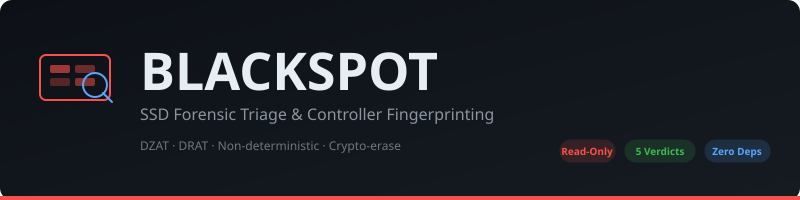

<p align="center">
  
</p>

<p align="center">
  <strong>Host-side SSD forensic triage & controller-behavior fingerprinting</strong>
</p>

<p align="center">
  
  
  
  
  
  
</p>

<p align="center">
  <a href="#the-problem">Problem</a> · <a href="#how-it-works">How It Works</a> · <a href="#architecture">Architecture</a> · <a href="#quick-start">Quick Start</a> · <a href="#verdicts">Verdicts</a> · <a href="#demo">Demo</a> · <a href="#scope-honesty">Scope</a>
</p>

---

> *The pirate's black spot was a mark of judgment. BLACKSPOT hands a verdict to a
> drive: is the deleted evidence still **alive** in NAND, or already **scuttled**
> by garbage collection — before you burn thousands on a destructive chip-off?*

## The Problem

Classic disk forensics assumes a deleted block stays readable until overwritten.
On SSDs that assumption is quietly **false**:

| SSD Behavior | What the host sees | What NAND holds | Implication |
|---|---|---|---|
| **DZAT** (Deterministic Zero After TRIM) | All zeros | Likely intact | Drive is *lying* — image NOW |
| **DRAT** (Deterministic Read After TRIM) | Stale data | Likely intact | Data visible but may GC any moment |
| **Non-deterministic** | Random mix | Unknown | Race condition with GC |
| **Post-GC** | Zeros | Physically erased | Too late — chip-off or nothing |
| **Crypto-erase** | Zeros | Encrypted garbage | Key destroyed — game over |

Investigators currently find out *after* a $2–5k chip-off. That's backwards.

## How It Works

BLACKSPOT is a **read-only triage** tool. It does **not** recover data — once a
controller erases a physical page, the host path cannot reach it. That's physics.

Instead, it answers the question that determines your next $5,000 decision:

```
                ┌──────────────┐
                │  Raw Capture │  Read maps from target LBAs
                └──────┬───────┘
                       │
                ┌──────▼───────┐
                │  Fingerprint │  DZAT / DRAT / Non-deterministic
                │    Engine    │  Repeated reads of trimmed LBAs
                └──────┬───────┘
                       │
                ┌──────▼───────┐
                │   Decision   │  Auditable rule chain
                │     Tree     │  (see docs/DECISION_TREE.md)
                └──────┬───────┘
                       │
                ┌──────▼───────┐
                │   Verdict    │  ALIVE / LYING / FADING /
                │  + Rationale │  SCUTTLED / CRYPTO-ERASED
                └──────┬───────┘
                       │
                ┌──────▼───────┐
                │  Court Report│  Markdown with full chain-of-reasoning
                └──────────────┘
```

## Architecture

```
src/blackspot/
├── fingerprint.py    # Controller behavior detection (DZAT/DRAT/non-det)
├── triage.py         # Decision tree engine → verdicts with rationale
├── models.py         # Data models (CaptureData, Verdict, TriageResult)
└── cli.py            # CLI: triage, report, capture, simulate

samples/              # 6 sample packs (DZAT, DRAT, non-det, powercut, fading, crypto)
tests/                # Smoke tests for the decision tree (8 passing)
scripts/
├── loop_canary.sh    # Portable loop-device demo (no real SSD needed)
└── real_capture.sh   # Real Linux block-device capture + triage
docs/
├── BSIDESSF_CFP.md   # BSidesSF 2027 talk submission
├── TALK_OUTLINE.md    # 45-minute presentation structure
├── WORKSHOP.md        # Hands-on workshop plan
├── DECISION_TREE.md   # The full auditable decision tree
├── NOVELTY.md         # Why this hasn't been done before
├── DEMO.md            # Demo walkthrough (loop canary)
└── REAL_CAPTURE.md    # Real capture methodology + results
```

## Quick Start

```bash
git clone https://github.com/p17433308-cmyk/dead-mens-tales.git
cd dead-mens-tales
pip install -e .
```

**Run the test suite:**
```bash
pytest tests/
```

**Triage a capture file:**
```bash
PYTHONPATH=src python3 -m blackspot.cli triage --capture samples/example_dzat.json
```

**JSON output for automation:**
```bash
PYTHONPATH=src python3 -m blackspot.cli triage --capture samples/example_drat.json --json
```

All analysis runs on captured read maps (JSON) — fully reproducible offline and
safe to run in a workshop without touching live hardware.

## Verdicts

| Verdict | Meaning | Action |
|---|---|---|
| `ALIVE` | Data readable at host level | Image immediately |
| `LYING` | Controller returns zeros but NAND likely holds data (DZAT) | Image raw + escalate |
| `FADING` | Non-deterministic TRIM; data degrading | Image NOW, race against GC |
| `SCUTTLED` | GC has physically erased pages | Chip-off or accept loss |
| `CRYPTO-ERASED` | SED crypto-erase confirmed | Recovery impossible |

## Demo

**Loop-device canary** (no real SSD needed):
```bash
sudo bash scripts/loop_canary.sh
```
Creates a loop device, writes canary data, runs `fstrim`, and verifies whether
data persists in raw blocks. Validated on real Linux kernels.

**Real block-device capture:**
```bash
sudo bash scripts/real_capture.sh
```
Drives real Linux block devices through BLACKSPOT's triage pipeline with actual
TRIM ioctls. See `docs/REAL_CAPTURE.md` for methodology.

## Scope Honesty

- BLACKSPOT is **read-only** — it never writes to the target drive
- Modern self-encrypting drives doing a **confirmed crypto-erase** defeat all of
  this instantly — the key is gone, recovery is impossible, and BLACKSPOT says so
- Everything here targets the enormous installed base that is *not* crypto-erasing:
  consumer drives, TRIM-only wipes, and misconfigured SEDs
- Real controller fingerprinting needs a physical SSD; the loop-device demo is a
  portable, honest fallback

## Citation

If you use BLACKSPOT in forensic research:
```
BLACKSPOT: Host-Side SSD Forensic Triage Tool
Dr. Sapna S, Prajwal Chowdary — CISFCR, PES University, Bangalore
BSidesSF 2027
```

## License

Apache-2.0. Research and educational use for authorized forensic investigation.
